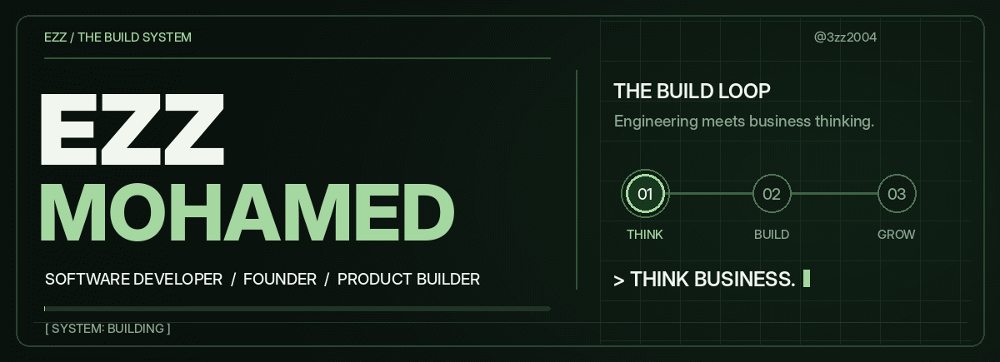

<div align="center">

  

  <br /><br />

  

  <p>
    <strong>
      SOFTWARE DEVELOPER &nbsp; / &nbsp;
      FOUNDER &nbsp; / &nbsp;
      PRODUCT BUILDER
    </strong>
  </p>

</div>

<br />

<table>
  <tr>
    <td width="62%" valign="top">

<h3>01 &nbsp; / &nbsp; BEYOND THE CODE</h3>

<p>
<strong>
I don't just build software.
I think about the business behind it.
</strong>
</p>

<p>
I'm Ezz. I work where software engineering,
product thinking, and business strategy meet.
</p>

<p>
I like solving the whole problem:
finding what matters, deciding what to build,
and turning it into something people actually need.
</p>

</td>
<td width="38%" valign="top">

<h3>↗ &nbsp; CURRENT DIRECTION</h3>

<p>
<code>ENGINEERING</code> &nbsp; Software that works
</p>

<p>
<code>PRODUCT</code> &nbsp; Ideas worth testing
</p>

<p>
<code>BUSINESS</code> &nbsp; Strategy that makes sense
</p>

<p>
<code>STATUS</code> &nbsp; Building &amp; learning
</p>

</td>
</tr>
</table>

---

## `02 / ONE MINDSET. THREE DISCIPLINES.`

<table>
<tr>

<td width="33%" valign="top">

<h3>⌘ Engineering</h3>

<p>
Software Development<br/>
System Architecture<br/>
AI &amp; Automation
</p>

</td>

<td width="33%" valign="top">

<h3>◇ Product</h3>

<p>
SaaS Exploration<br/>
Product Development<br/>
Build · Test · Iterate
</p>

</td>

<td width="34%" valign="top">

<h3>↗ Business</h3>

<p>
Business Strategy<br/>
Marketing Strategy<br/>
Startup Growth
</p>

</td>

</tr>
</table>

---

## `03 / THE PRODUCT LAB`

I'm exploring and building SaaS products around
**problems worth solving**.

Not every experiment deserves a launch.

Not every idea needs to become a company.

The work is figuring out what matters —
and building from there.

<details>

<summary>
<strong>＋ &nbsp; OPEN PRODUCT LAB</strong>
</summary>

<br/>

```text
[01] DISCOVER
      Find problems worth solving.

[02] VALIDATE
      Challenge assumptions.

[03] DESIGN
      Design the right solution.

[04] BUILD
      Turn ideas into working products.

[05] ITERATE
      Learn. Improve. Repeat.
```

As projects are ready to share, this space
will hold real demos, technical decisions,
and lessons from the build.

</details>

---

## `04 / MY DECISION FILTER`

| Before I build, I ask... | Because... |
| :--- | :--- |
| **Is this a real problem?** | Interesting tech isn't automatically useful. |
| **Who is it for?** | Features mean nothing without people. |
| **Does the business model make sense?** | Great code can't fix broken economics. |
| **What's the smallest useful version?** | Validate, learn, then scale. |

<br/>

<details>

<summary>
<strong>＋ &nbsp; ENGINEERING MINDSET</strong>
</summary>

<br/>

I care about good architecture, but I don't
confuse complexity with quality.

The best system solves the right problem
without becoming a problem itself.

</details>

<br/>

<details>

<summary>
<strong>＋ &nbsp; BUSINESS MINDSET</strong>
</summary>

<br/>

I connect engineering decisions with positioning,
business models, distribution, and growth.

The product is only one part of the business.

</details>

<br/>

<details>

<summary>
<strong>＋ &nbsp; FOUNDER MINDSET</strong>
</summary>

<br/>

I believe building a company starts long before
writing the first line of code.

It starts with understanding people,
recognizing opportunities, and being willing
to test assumptions.

I don't want to build products just because I can.

I want to build things that deserve to exist.

</details>

---

## `05 / HOW I BUILD`

<div align="center">

```text
     UNDERSTAND
          |
          v
      STRATEGIZE
          |
          v
       ARCHITECT
          |
          v
         BUILD
          |
          v
         TEST
          |
          v
        IMPROVE
          |
          v
        REPEAT
```

**THINK LIKE A FOUNDER. BUILD LIKE AN ENGINEER.**

</div>

---

## `06 / THE BUILDER'S TERMINAL`

```python
class Builder:

    def __init__(self):
        self.mindset = "Founder"
        self.execution = "Engineer"
        self.focus = [
            "Software",
            "SaaS",
            "AI",
            "Business Strategy"
        ]

    def build(self, idea):

        problem = self.understand(idea)

        if not self.validate(problem):
            return "Rethink the idea."

        product = self.develop(problem)

        return self.learn_and_improve(product)
```

---

## `07 / WHAT'S NEXT?`

I'm currently exploring different ideas,
building software, and learning more about
what makes products and businesses successful.

Some projects are still experiments.

Others are taking shape.

And some haven't been written yet.

**I'm not interested in building more things.**

**I'm interested in building better things.**

---

<div align="center">

### STILL IN BUILD MODE.


<br/>

### THINK BUSINESS. BUILD TECHNOLOGY.

<br/>

<a href="https://github.com/3zz2004?tab=repositories">


</a>

<br/><br/>

**EZZ MOHAMED**

`SOFTWARE` &nbsp; `PRODUCT` &nbsp; `BUSINESS`

<br/>

*Still learning. Still experimenting. Always building.*

<br/>

**THE BEST IS YET TO BE BUILT.**

</div>
