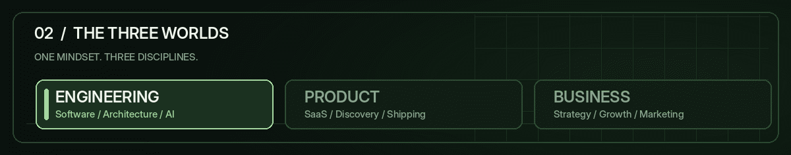
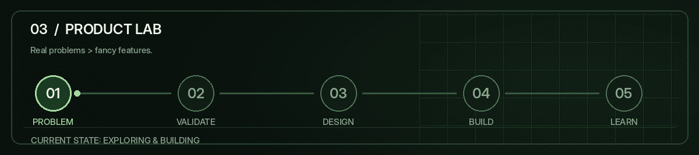
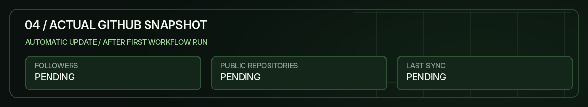
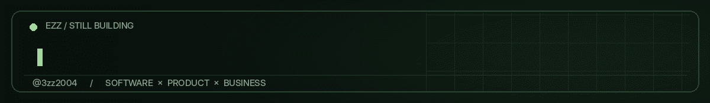

 

### I DON'T JUST BUILD SOFTWARE. I THINK ABOUT THE BUSINESS BEHIND IT.

SOFTWARE ENGINEERING &nbsp; × &nbsp; PRODUCT &nbsp; × &nbsp; BUSINESS

  

<a href="#01--the-mind-behind-the-build"><b>ABOUT</b></a> &nbsp;·&nbsp;
<a href="#02--one-mindset-three-disciplines"><b>WHAT I DO</b></a> &nbsp;·&nbsp;
<a href="#03--the-product-lab"><b>PRODUCT LAB</b></a> &nbsp;·&nbsp;
<a href="#04--live-github-snapshot"><b>LIVE STATS</b></a>

---

### 01 / THE MIND BEHIND THE BUILD

I'm **Ezz Mohamed** — a software developer and founder who sees the bigger picture behind every product.

I help businesses and startups think through the **problem, business model, product strategy, and technology** — from an idea worth testing to software worth using.

I care about the questions that come before the code: **Who needs this? Why would they choose it? Does the business make sense?**

> **Think like a founder. Build like an engineer.**

 

### 02 / ONE MINDSET. THREE DISCIPLINES.

<table>
<tr>
<td width="33%" valign="top"><b>01 / ENGINEERING</b>  Software development System architecture AI & automation</td>
<td width="33%" valign="top"><b>02 / PRODUCT</b>  SaaS exploration Product development Build · Test · Iterate</td>
<td width="34%" valign="top"><b>03 / BUSINESS</b>  Business strategy Marketing strategy Startup growth</td>
</tr>
</table>

 

### 03 / THE PRODUCT LAB

I'm exploring and building SaaS products around real problems. **No invented launches, no placeholder projects.** I'll share the work when it's ready to be useful.

<b>↗ OPEN PRODUCT LAB — THE BUILD PROCESS</b>

 

| Stage | The question I ask |
| --- | --- |
| **01 · Discover** | Is this a real problem? |
| **02 · Validate** | Would anyone use or pay for a solution? |
| **03 · Design** | What's the simplest useful version? |
| **04 · Build** | How can I make it reliable and maintainable? |
| **05 · Learn** | What should real feedback change? |

**Product demos, technical decisions, and real build notes will appear here as projects ship.**

 

### 04 / LIVE GITHUB SNAPSHOT

Actual public GitHub numbers · updated daily through GitHub Actions · timestamp = last successful refresh

<b>↗ HOW THE DYNAMIC PROFILE WORKS</b>

 

- The moving header, disciplines, product lab, and footer are animated GIFs stored in this repository.
- The statistics image is regenerated using the GitHub API and a scheduled GitHub Action.
- The timestamp is generated at refresh time; it is not a made-up date or a live clock.
- Product information is updated intentionally when there is real work to share.

 

### 05 / THE DECISION FILTER

<b>+ ENGINEERING MODE</b>

 

I value good architecture, but complexity isn't a feature. The best systems solve the right problem without becoming the problem.

<b>+ BUSINESS MODE</b>

 

Great code can't rescue a business model nobody needs. Product decisions need to connect to customers, positioning, economics, and growth.

<b>+ FOUNDER MODE</b>

 

Not everything that can be built should be built. I'd rather challenge the idea early than spend months shipping the wrong product.

 

### 06 / STILL IN BUILD MODE

<b>BETTER QUESTIONS → BETTER PRODUCTS → BETTER BUSINESSES.</b>

  

<a href="https://github.com/3zz2004?tab=repositories"><b>EXPLORE MY REPOSITORIES ↗</b></a>
&nbsp; · &nbsp;
<a href="https://github.com/3zz2004"><b>FOLLOW THE JOURNEY ↗</b></a>

  

<b>EZZ MOHAMED</b> &nbsp; / &nbsp; @3zz2004

