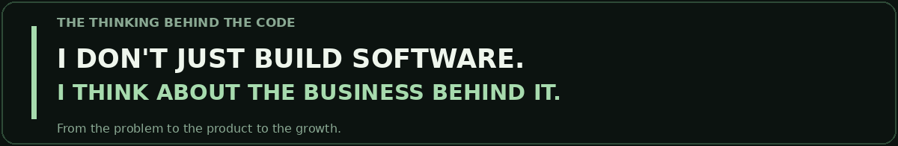
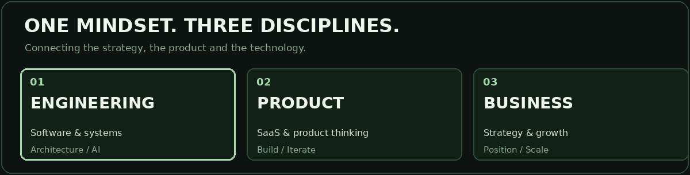
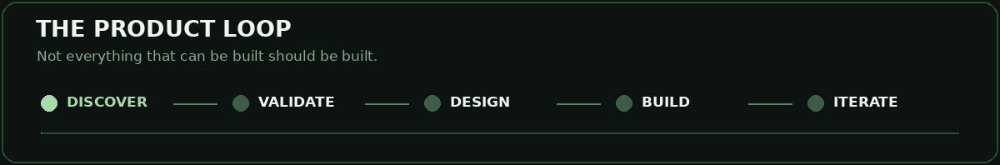
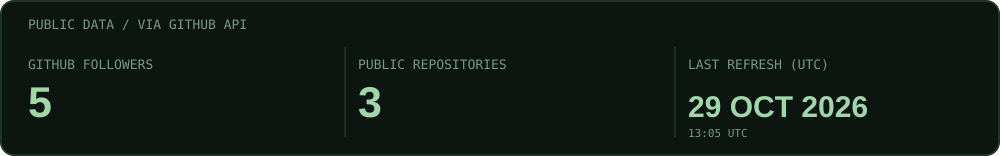
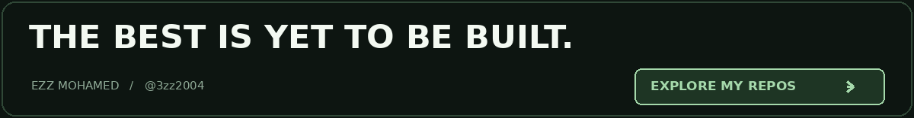

<!-- EZZ MOHAMED — Premium self-hosted animated GitHub profile -->

 

 

 

 

 

 

<!--
I work across software development, system architecture,
SaaS product building, business strategy and startup growth.
This profile uses the owner's real supplied photograph,
self-hosted animated artwork and authentic GitHub statistics.
No invented project launches, no manufactured activity.
-->
