 

**I DON'T JUST BUILD SOFTWARE. I THINK ABOUT THE BUSINESS BEHIND IT.**

Building at the intersection of technology, products, and business strategy.

  

<a href="#01--the-build"><b>THE BUILD</b></a> &nbsp;·&nbsp;
<a href="#02--the-person-behind-the-code"><b>WHOAMI</b></a> &nbsp;·&nbsp;
<a href="#03--the-product-lab"><b>PRODUCT LAB</b></a> &nbsp;·&nbsp;
<a href="#04--the-numbers"><b>ACTIVITY</b></a>

 

### 01 / THE BUILD

 

### 02 / THE PERSON BEHIND THE CODE

<table>
<tr>
<td width="46%" align="center" valign="top">

</td>
<td width="54%" align="center" valign="top">

</td>
</tr>
</table>

 

> **I'm Ezz Mohamed.** I develop software, think about the business behind it, and enjoy the messy space where ideas become products. I help businesses and startups connect their **strategy, product, and technology** — so they can build the *right thing*, not just build something.

 

### 03 / THE PRODUCT LAB

<b>↗ CURRENTLY BUILDING — SaaS &amp; SOFTWARE</b>

 

I'm exploring and developing SaaS products around problems worth solving. Nothing announced before it's real.

My build cycle: **Discover → Validate → Architect → Build → Learn.**

I'll share product demos, technical decisions, and progress here when they're ready.

<b>↗ HOW I THINK — ENGINEERING × BUSINESS</b>

 

Good software needs architecture, but a successful product needs more than code.

Before building, I ask: **Who is this for? Why should it exist? Does the business model work? Is software actually the best solution?**

**Think like a founder. Build like an engineer.**

 

### 04 / THE NUMBERS

Powered by GitHub's public data. Refreshed daily by Actions — not a real-time clock.

  

<a href="https://github.com/3zz2004?tab=repositories"><b>VIEW MY REPOSITORIES ↗</b></a>
&nbsp; / &nbsp;
<a href="https://github.com/3zz2004"><b>FOLLOW THE BUILD ↗</b></a>

  

EZZ MOHAMED &nbsp;·&nbsp; @3zz2004 &nbsp;·&nbsp; STILL IN BUILD MODE.

