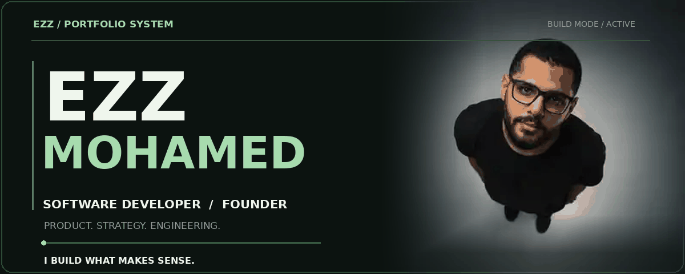

<!-- EZZ / THE BUILD SYSTEM. All display artwork is self-hosted. -->

<!--
SOFTWARE x PRODUCT x BUSINESS

Ezz Mohamed is a software developer and founder who works
where technology, business strategy and product development meet.

This README is intentionally visual, with subtle GIF animations,
an authentic avatar and GitHub data refreshed by Actions.
No invented projects, fake counters, or unsupported tech badges.
-->
