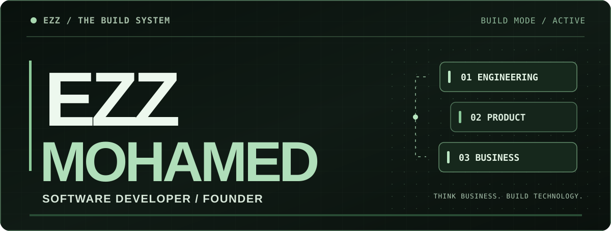
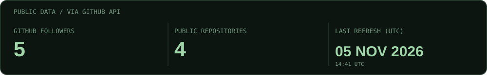

<!-- EZZ MOHAMED — GitHub profile -->

### Software Engineer · Full-Stack & AI Backend · Cybersecurity

I build complete, production-style products end to end — multi-tenant SaaS platforms, university systems and AI-powered backends —
with a strong focus on security, data isolation and clean architecture.

📍 Alexandria, Egypt · 🎓 B.Sc. Computer Science, Kafr El-Sheikh University

---

## 🚀 Featured Projects

| Project | What it is | Stack |
|---|---|---|
| **[ATLAS](https://github.com/3zz2004/ATLAS)** | University academic platform — student records, QR attendance, grades approval workflow, rankings, course chat. One API, three apps (admin, mobile, activation). | ASP.NET Core · EF Core · SQL Server · Flutter · Docker |
| **[HESSA](https://github.com/3zz2004/HESSA)** | Multi-tenant SaaS for tutoring centers in Egypt — QR attendance, fees and partial payments, exams, WhatsApp notifications to parents. Arabic RTL, mobile-first. | Next.js 16 · React 19 · Supabase · PostgreSQL RLS · TypeScript |
| **[SILZO](https://github.com/3zz2004/SILZO)** | Commerce operations platform for retailers — inventory ledger, orders, POS, suppliers, shipping and cash-on-delivery reconciliation, reports. | NestJS · Prisma · PostgreSQL · Next.js · pnpm monorepo |
| **[Basira](https://basiraa.vercel.app)** | AI-powered platform for detecting fake images, videos and AI-generated content. **[Live demo →](https://basiraa.vercel.app)** | AI / Machine Learning · TypeScript |

> Source code of commercial projects is private — each repository is a public showcase. Live walkthroughs available on request.

## 🛠️ Tech Stack

**Languages:** C# · TypeScript · JavaScript · Dart · SQL · Python  
**Back-End:** ASP.NET Core · Entity Framework Core · NestJS · Prisma · REST APIs · JWT · CQRS / MediatR  
**Front-End & Mobile:** Next.js · React · Tailwind CSS · Flutter  
**Data:** PostgreSQL · SQL Server · Supabase (Row Level Security)  
**AI:** LLM integration · Retrieval & grounding (RAG) · Prompt engineering · AI evaluation  
**DevOps & Testing:** Docker · Linux · Git · Caddy · Vitest · Playwright · Supertest  
**Security:** Network security · Vulnerability assessment · Secure authentication · Data encryption

## 💼 Experience

- **Software Developer** — Joomy *(Aug 2026 – Present)*
- **AI Backend Engineering Intern** — FlyRank AI *(Jul – Sep 2026)*
- **Information Security Intern** — Industrial Development Bank (IDB) *(Jul – Aug 2026)*
- **Technology & Digital Transformation Intern** — Orange Egypt *(Jul – Aug 2026)*
- **Web Developer (Freelance)** — DAM CODE, Netherlands *(Sep 2025 – Jan 2026)*

## 📊 Activity

